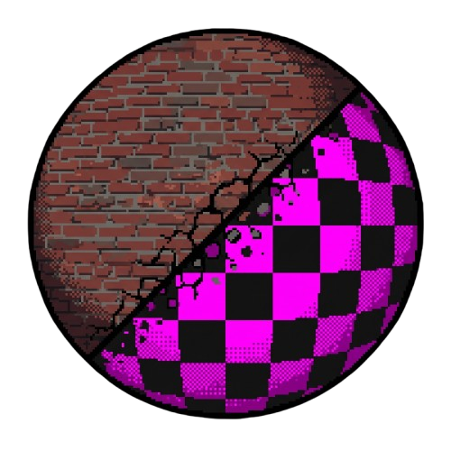

<div align="center">



# VMT-Studio


[-F37021.svg)](https://developer.valvesoftware.com/wiki/Half-Life_Model_Viewer)

*Read this in other languages: [Español](README.es.md)*

</div>

**VMT-Studio** is a high-performance, modern material studio, parameter inspector, and real-time 3D previewer for Valve's Source Engine materials (`.vmt`) and textures (`.vtf`).

Unlike generic material viewers that attempt to approximate Source shaders through custom OpenGL or Vulkan reimplementations, **VMT-Studio uses Valve's Source Engine renderer natively via an embedded Half-Life Model Viewer (HLMV) architecture**. This guarantees 100% authentic, 1:1 in-game visual fidelity for all complex Source shaders (including Phong, Bumpmaps, Envmap cubemaps, Lightwarps, Detail textures, and Brush geometry).

---

## Table of Contents

- [Key Features](#key-features)
- [Architecture](#architecture)
  - [Dual-Process Architecture (x64 UI + Win32 HLMV)](#dual-process-architecture-x64-ui--win32-hlmv)
  - [Native Brush & Studio Model Rendering](#native-brush--studio-model-rendering)
  - [Modules Overview](#modules-overview)
- [Supported Games & Engines](#supported-games--engines)
- [Portable Release (Quick Start)](#portable-release-quick-start)
- [Build Requirements](#build-requirements)
- [Building the Project](#building-the-project)
  - [Step 1: Clone and Initialize Submodules](#step-1-clone-and-initialize-submodules)
  - [Step 2: Build VTFLib++ (32-bit and 64-bit)](#step-2-build-vtflib-32-bit-and-64-bit)
  - [Step 3: Build the 32-bit HLMV Backend](#step-3-build-the-32-bit-hlmv-backend)
  - [Step 4: Build the 64-bit Qt 6 Frontend](#step-4-build-the-64-bit-qt-6-frontend)
- [Running and Configuring](#running-and-configuring)
- [Testing](#testing)
- [Licenses and Legal Notices](#licenses-and-legal-notices)
- [AI Disclosure](#ai-disclosure)

---

## Key Features

- **100% Native Source Engine Rendering**:
  - Leverages Valve's actual Direct3D 9 `materialsystem.dll`, `tier0.dll`, and `vstdlib.dll` from your local game installation.
  - Zero approximation: exact specular highlights, fresnel curves, half-lambert shading, lightwarps, blend modes, and cubemap reflections.
- **Dual-Surface Preview: Models & Brushes**:
  - **Studio Models**: Sphere, Cube, Cylinder, Plane, or custom `.mdl` models with full animation playback and speed control.
  - **Native Brush Geometry**: Real world geometry (`brush_wall`, `brush_floor`, `brush_cube`, and `brush_displacement`) built using Source engine mesh builders (`CMeshBuilder`) with authentic normals, lightmap UVs, and vertex colors for world shaders (`LightmappedGeneric`, `WorldVertexTransition`).
- **Two-Way Live Editing & Synchronization**:
  - **Visual Parameter Inspector**: Dynamic, schema-driven property editor with interactive sliders, checkboxes, color pickers, and texture selectors.
  - **Code Editor**: Clean syntax-highlighted VMT text editor.
  - **Instant Debounced Sync**: Changes in the inspector or text editor update the running 3D engine in real time (250 ms debounce).
  - **Full Undo / Redo**: Unified undo/redo stack across both the inspector and text editor (`Ctrl+Z` / `Ctrl+Y`).
- **Material Browser (`F3`)**:
  - Deep-scans loose game folders and mounted `.vpk` archives directly without unpacking.
  - Real-time thumbnail generation using the native engine with automatic disk caching (`%LOCALAPPDATA%\VMTStudio\thumbnails\`).
- **Schema Validation & Diagnostics (`F7`)**:
  - Linting against official Source shader schemas (`data/schema`).
  - Flags unknown shaders, deprecated or unsupported parameters, type mismatches, and missing dependencies (e.g., `$phongboost` defined without `$phong`).
  - **Live VFS Texture Check**: Queries the connected game's virtual filesystem (`IFileSystem`) to verify whether referenced VTF textures exist on disk or inside mounted VPKs.
- **Lighting and Scene Studio**:
  - Comprehensive lighting control: ambient light, key light (direction, azimuth, elevation, color), fill light, and background clear color.
  - Environment presets: *Studio Dark*, *Studio Light*, *Outdoor*, and *Flat*.
- **Shading & Debug Modes**:
  - Textured / Shaded, Flatshaded, Wireframe, and Normal map / Bumpmap preview.
- **Automated Game Discovery & Steam Library Detection**:
  - Automatically queries the Windows registry (`HKCU\Software\Valve\Steam`) and `STEAMPATH` to detect local Steam installations.
  - Recursively parses multi-library configuration manifests (`libraryfolders.vdf`) to detect all installed Source games and custom mods across any drive.
  - Interactive **Known games** dropdown in Connection Settings with one-click path configuration and live install status indicators.
- **Comprehensive Engine Install Validation**:
  - Strict multi-stage verification before launching the engine backend: verifies folder structure, `gameinfo.txt`, PE headers, and binary architecture (enforcing 32-bit x86 binaries required by the engine).
  - Validates required engine DLLs (`tier0.dll`, `vstdlib.dll`, `filesystem_stdio.dll`, `materialsystem.dll`, `shaderapidx9.dll`).
  - Best-effort export table validation (`CreateInterface`, `CommandLine_Tier0`) with actionable diagnostic error tags (`empty folder`, `missing DLL`, `wrong arch`, `no exports`).
- **High-Throughput VMT Parsing & Optimized VTF Decoding**:
  - **`vmt_core`**: Zero-allocation token scanner with ASCII delimiter lookup tables, binary-searched `LineTable` for instant source location mapping, and byte-exact lossless AST round-tripping.
  - **`vtf_reader`**: Direct fast-path downscaling for uncompressed RGBA8888 without intermediate allocations, immediate buffer cleanup to minimize peak memory, and thread-safe scoped decoding.
- **Safe, Non-Destructive Workflow**:
  - Atomic file writes (`.tmp` swap) to prevent corrupted materials on crashes or disk errors.
  - Loose override workflow: `File > Save to game folder...` writes edited materials directly into the game's `materials/` folder to override VPK contents seamlessly.

---

## Architecture

### Dual-Process Architecture (x64 UI + Win32 HLMV)

Valve's Source Engine 2013 and retail games (Half-Life 2, Counter-Strike: Source, Team Fortress 2, Garry's Mod) are legacy 32-bit (`x86`) binaries. Modern UI frameworks like **Qt 6** are built and optimized for 64-bit (`x64`) toolchains. Loading 32-bit engine DLLs directly into a 64-bit process is impossible on Windows.

To solve this, **VMT-Studio** employs an out-of-process client-server architecture:

```
┌─────────────────────────────────────────────────────────────┐
│                    vmtstudio.exe (x64)                      │
│                  Frontend UI (Qt 6 MSVC)                    │
│                                                             │
│  ┌───────────────────────┐       ┌───────────────────────┐  │
│  │   Visual Inspector    │       │   Syntax Code Editor  │  │
│  └───────────┬───────────┘       └───────────┬───────────┘  │
│              │                               │              │
│              └───────────────┬───────────────┘              │
│                              ▼                              │
│                    ┌──────────────────┐                     │
│                    │ Viewport Widget  │ ◄─── (Embeds HWND)  │
│                    └─────────┬────────┘                     │
└──────────────────────────────┼──────────────────────────────┘
                               │ Win32 IPC (WM_COPYDATA)
                               ▼
┌─────────────────────────────────────────────────────────────┐
│                   hlmv_backend.exe (x86)                    │
│              Rendering Backend (Win32 / C++17)              │
│                                                             │
│  ┌───────────────────────────────────────────────────────┐  │
│  │   HLMV Core + MX Toolkit + Native Direct3D 9 View     │  │
│  └───────────────────────────┬───────────────────────────┘  │
│                              ▼                              │
│  ┌───────────────────────────────────────────────────────┐  │
│  │       Native Game Engine DLLs (materialsystem.dll,    │  │
│  │          tier0.dll, vstdlib.dll, filesystem)          │  │
│  └───────────────────────────────────────────────────────┘  │
└─────────────────────────────────────────────────────────────┘
```

1. **`vmtstudio` (Qt 6 x64)**: Runs the modern user interface, handles file I/O, parses schemas, provides syntax highlighting, and hosts a native Win32 child container (`ViewportWidget`).
2. **`hlmv_backend` (Win32 x86)**: Launched as a child process with `-embed <HWND> -game <dir> -bin <dir>`. It loads the game's native Source Engine binaries, initializes Direct3D 9, and reparents its rendering viewport directly into the Qt UI widget.
3. **High-Speed Win32 IPC**: The frontend dispatches commands (`SET_MATERIAL`, `RELOAD_MATERIAL`, `SET_SHAPE`, `SET_LIGHTING`, `CAPTURE_THUMBNAIL`, etc.) via `WM_COPYDATA` messages with zero perceptible latency.

### Native Brush & Studio Model Rendering

Most material viewers can only display textures on a model sphere. However, Source Engine materials fall into two distinct rendering categories:
- **Studio Models (`VertexLitGeneric`)**: Requires vertex bone weighting, ambient cube calculations, and studio lighting pipelines.
- **World Brushes (`LightmappedGeneric`, `WorldVertexTransition`)**: Requires surface lightmaps, flat brush planes, or displacement meshes.

`hlmv_backend` includes a custom `brush_render` module that interfaces directly with Valve's `IMesh` and `CMeshBuilder`. It procedurally constructs authentic brush surfaces (Wall, Floor, Cube, Displacements) with accurate normals, lightmap coordinates, and vertex colors, allowing brush shaders to render faithfully without graphical anomalies.

### Modules Overview

- **`vmt_core`**: Standalone, lossless KeyValues parser, AST document model, and serializer. Features zero-allocation token scanning with lookup tables, binary-searched `LineTable` location tracking, and byte-exact round-tripping. Preserves comments, exact whitespace formatting, casing, and quoted/unquoted parameters. Zero dependencies on Windows or Qt.
- **`vtf_reader`**: Fast VTF image decoder and header parser wrapping `VTFLib++`. Decodes DXT1, DXT5, RGBA8888, BC4/BC5, and cubemap/volume mipmaps into RGBA8 buffers with optimized fast paths for uncompressed textures and minimized peak memory usage.
- **`hlmv_backend`**: 32-bit out-of-process engine runner incorporating Valve's Half-Life Model Viewer, MX Toolkit (`mxtk`), IPC listener, and brush mesh builder.
- **`engine_bridge`**: IPC communication bridge, subprocess lifecycle management, PE header inspection, and filesystem compatibility shims (such as runtime vtable fixups for Garry's Mod `VFileSystem022`).
- **`game_profiles`**: Auto-detection logic for installed Source games. Reads Steam library configurations across all drives, parses `gameinfo.txt`, and performs comprehensive PE binary inspection (32-bit x86 architecture, required DLLs, and export validation).
- **`ui`**: The Qt 6 GUI application (`vmtstudio`), docks, property inspectors, syntax highlighter, and dialogs.
- **`data/schema`**: JSON schema definitions for Source shaders (`VertexLitGeneric`, `LightmappedGeneric`, `UnlitGeneric`, `WorldVertexTransition`, `Water`, `Refract`, `Sprite`).

---

## Supported Games & Engines

The engine bridge supports automatic connection to any Source Engine branch based on the Source SDK 2013 / Alien Swarm branch, including:
- **Half-Life 2** (and Episodes 1 & 2)
- **Portal**
- **Counter-Strike: Source**
- **Team Fortress 2**
- **Source SDK Base 2013 Singleplayer / Multiplayer**
- **Garry's Mod** (VPK and filesystem browsing via runtime vtable shim)
- **Custom Source Engine Mods** containing a valid `gameinfo.txt` and `/bin` folder.

---

## Portable Release (Quick Start)

If you prefer not to build VMT-Studio from source, a precompiled portable package is ready to use:

1. **Download**: Grab `vmt-studio-v0.1.0-windows-x64.zip` from the project's [Releases](https://github.com/your-username/VMT-Studio/releases) page.
2. **Extract**: Unzip the archive to any folder (e.g., `C:\Tools\VMT-Studio`). No installation or administrator rights are required.
3. **Run**: Launch `vmtstudio.exe`.
4. **Connect to Source Engine**:
   - Open **Game > Connection Settings...**.
   - Select your installed game from the **Known games** dropdown, or click **Discover...** to automatically scan your Steam libraries across all storage drives.
   - Alternatively, specify manually the game directory (the folder with `gameinfo.txt`, such as `Half-Life 2/hl2`) and the engine `/bin` directory.
   - Click **Test Connection** to validate the installation (verifies 32-bit PE architecture, required DLLs, and engine exports).
5. **Start Editing**: Open any `.vmt` file via **File > Open** or the **Material Browser (`F3`)** to inspect and preview materials in real time.

> [!NOTE]
> The portable ZIP package bundles `vmtstudio.exe` (64-bit Qt 6 frontend), `hlmv_backend.exe` (32-bit native renderer backend), `VTFLib.dll`, and all required Qt 6 runtime dependencies. No proprietary Valve assets or DLLs are distributed; they are loaded dynamically from your local game installation.

---

## Build Requirements

- **Operating System**: Windows 10 or Windows 11 (64-bit).
- **Compiler**: Visual Studio 2022 (MSVC v143 toolset) with the **Desktop development with C++** workload.
- **Build System**: CMake 3.21 or later.
- **Qt Framework**: Qt 6.8+ (MSVC 2022 64-bit).
- **Source SDK 2013**: Public headers and import libraries (`SOURCE_SDK_PUBLIC` points to `src/public`).
- **Git**: Configured with submodule support.

---

## Building the Project

Because the rendering backend must be compiled for **Win32 (32-bit)** to load Valve's 32-bit DLLs, while the frontend GUI is compiled for **x64 (64-bit)** with Qt 6, the build involves a two-phase compilation:

### Step 1: Clone and Initialize Submodules

```powershell
git clone --recursive https://github.com/your-username/VMT-Studio.git
cd VMT-Studio
```

If already cloned:
```powershell
git submodule update --init --recursive
```

### Step 2: Build VTFLib++ (32-bit and 64-bit)

1. Apply the build patch to VTFLib++ (replaces `afxres.h` with `winres.h` so MFC is not required):
   ```powershell
   cmake -P thirdparty/patches/apply_vtflib_patches.cmake
   ```

2. Build 32-bit VTFLib++ (for `hlmv_backend` and 32-bit tests):
   ```powershell
   cmake -B thirdparty/vtflib/build_vtflib -A Win32 -DVTFLIB_BUILD_VTFCMD=OFF -DVTFLIB_BUILD_VTFEDIT=OFF
   cmake --build thirdparty/vtflib/build_vtflib --config Release
   ```

3. Build 64-bit VTFLib++ (for 64-bit `vmtstudio`):
   ```powershell
   cmake -B thirdparty/vtflib/build_vtflib64 -A x64 -DVTFLIB_BUILD_VTFCMD=OFF -DVTFLIB_BUILD_VTFEDIT=OFF
   cmake --build thirdparty/vtflib/build_vtflib64 --config Release
   ```

### Step 3: Build the 32-bit HLMV Backend

Configure and build the 32-bit target to generate `hlmv_backend.exe`:

```powershell
cmake -S . -B build -A Win32 -DSOURCE_SDK_PUBLIC="<path-to-source-sdk-2013>/src/public"
cmake --build build --config Release --target hlmv_backend
```

### Step 4: Build the 64-bit Qt 6 Frontend

Configure and build the 64-bit frontend. CMake will automatically copy `build/bin/Release/hlmv_backend.exe` next to `vmtstudio.exe` and invoke `windeployqt`:

```powershell
cmake -S . -B build64 -A x64 -DCMAKE_PREFIX_PATH="C:/Qt/6.8.2/msvc2022_64"
cmake --build build64 --config Release --target vmtstudio
```

The resulting standalone executable with all required runtimes will be located at:
```
build64/bin/Release/vmtstudio.exe
```

---

## Running and Configuring

1. Launch `build64/bin/Release/vmtstudio.exe`.
2. Open **Game > Connection Settings...**:
   - Select an installed game directly from the **Known games** dropdown, or click **Discover...** to scan any custom Steam library or Source SDK folder.
   - Or manually set the **Game Directory** (the directory containing `gameinfo.txt`, e.g., `C:/Program Files (x86)/Steam/steamapps/common/Half-Life 2/hl2`) and **Bin Directory** (e.g., `C:/Program Files (x86)/Steam/steamapps/common/Half-Life 2/bin`).
   - Click **Test Connection** to run the live install validation (checks 32-bit PE architecture, required DLLs, and engine exports).
3. Open any `.vmt` file via **File > Open**, or browse the game files directly with the **Material Browser (`F3`)**.
4. The 3D viewport will automatically spawn the embedded HLMV backend and render the material with full Source Engine fidelity.

---

## Testing

Run the test suite using CTest:

```powershell
# Run 64-bit core, parser, and VTF decoding tests
ctest --test-dir build64 -C Release --output-on-failure

# Run 32-bit engine bridge and UI tests
ctest --test-dir build -C Release --output-on-failure
```

---

## Licenses and Legal Notices

### Valve Corporation Disclaimer
- **VMT-Studio does NOT distribute any proprietary Valve binaries, textures, models, or copyrighted game assets.**
- Engine DLLs, materials, sounds, and models are loaded dynamically at runtime from a user-supplied, legally acquired local Source Engine game installation.
- *Valve*, the *Valve logo*, *Half-Life*, the *Half-Life logo*, *Source*, the *Source logo*, *Counter-Strike*, and *Team Fortress* are trademarks and/or registered trademarks of **Valve Corporation**.

### Third-Party Licenses
- **VTFLib++**: Licensed under the **GNU Lesser General Public License v2.1 (LGPL-2.1)**. The license text is available at `thirdparty/vtflib/LGPL.txt`. VTFLib++ is linked as a dynamic library (DLL). Source code and compilation patches are provided in full within `thirdparty/`. (Shut out to @ficool2, for this lib and all his contributions to the Source Engine community)
- **Qt 6**: Licensed under **LGPLv3** / Commercial. Copyright (C) The Qt Company Ltd.
- **Source SDK 2013**: Used under the Valve Source SDK License.

### VMT-Studio License
This project is open-source software licensed under the **MIT License**. See [LICENSE](LICENSE) for details.

---

## AI Disclosure

Parts of this project were designed, written, refactored, and documented with the assistance of Artificial Intelligence (AI).

If you have an issue with AI-assisted software development: **we genuinely do not care about your opinion**. The tool works, it renders Source engine materials natively with 100% fidelity, solves real problems, and is free and open-source. Use it or don't.

